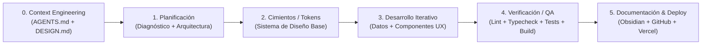

# ⚙️ Metodología Oficial de Trabajo en Plataformas Agénticas (Antigravity 2.0)

Cuando trabajamos con modelos avanzados dentro de plataformas agénticas como **Google Antigravity**, Cursor o Claude Code, el ciclo tradicional de software evoluciona hacia el **Desarrollo Guiado por Contexto y Verificación Agéntica (Agentic SDLC)**.

Tu intuición (*Planificar → Implementar → Desarrollar → Probar → Desplegar*) es muy acertada, pero en entornos con agentes de IA añadimos una **Fase 0 crítica** llamada **Ingeniería de Contexto (Context Engineering)**.

---

## 🔄 El Orden Exacto de 6 Etapas en Antigravity

### Etapa 0: Ingeniería de Contexto y Reglas (`Context Engineering`)
Antes de pedirle al modelo que escriba código, **blindamos su contexto** para que no improvise ni genere "AI slop":
- **`AGENTS.md` / `GEMINI.md` (Reglas de Proyecto)**: Archivo en la raíz que el agente lee automáticamente. Define qué gestor usar (`pnpm` exclusivo), qué estilo visual respetar y qué prohibiciones existen.
- **`DESIGN.md` (Estándar Refero Styles)**: Traduce el diseño visual en reglas exactas (colores hexadecimales por rol, tipografía, bordes de `1px`, qué hacer y qué no hacer).

### Etapa 1: Planificación y Alineación (`/plan` o `/grill-me`)
- Se analiza el estado actual del código y del negocio (en nuestro caso, cruzando tu web con tus CVs reales).
- Se definen las fases paso a paso (*step-by-step*) con entregables verificables.

### Etapa 2: Implementación de Cimientos (Design Tokens & Base)
- Primero se programan las variables globales (`globals.css`) y la configuración del motor (`tailwind.config.ts`) junto con los contratos de datos (`content/es.json` y `content/en.json`).
- **Por qué va antes del desarrollo de pantallas**: Si los tokens base están listos, todos los componentes nuevos nacen alineados al 100% con el sistema de diseño.

### Etapa 3: Desarrollo Modular de UI y UX
- Se construyen los componentes interactivos uno por uno o por bloque funcional:
  1. Navegación + Paleta de Comandos (`⌘K`).
  2. Hero + Simulador Interactivo de Arquitectura IA.
  3. Bento Grid Técnico de Servicios.
  4. Dossier de Trayectoria, Métricas y Certificaciones.

### Etapa 4: Prueba y Verificación Automatizada (`Automated QA Gate`)
- Un agente serio **nunca da por terminado un desarrollo sin ejecutar pruebas reales en consola**:
  - `pnpm run lint` (Calidad de código y reglas de React/Next.js)
  - `pnpm run typecheck` (Cero errores de tipos en TypeScript)
  - `pnpm run test` (Pruebas unitarias y de accesibilidad con `jest` y `jest-axe`)
  - `pnpm run build` (Compilación real de producción de Next.js)

### Etapa 5: Documentación Viva y Despliegue (`Docs-as-Code & Deploy`)
- Se actualiza la bóveda de **Obsidian (`docs/`)**, se hace `git commit` limpio hacia **GitHub** y se despliega en producción (Vercel).

---

## 🧩 ¿Qué son y cuándo usamos Rules, Skills, MCPs y Slash Commands?

Para que domines la terminología real de Antigravity (y puedas incluso explicarla a tus clientes en tus asesorías):

| Elemento | ¿Qué es en lenguaje claro? | ¿Cómo lo usamos en tu proyecto? |
| :--- | :--- | :--- |
| **Rules (`AGENTS.md`)** | Las **"Leyes de la Casa"**. Se cargan siempre para que la IA no cometa errores de seguridad ni rompa el estilo. | Ya hemos creado `[AGENTS.md](../../AGENTS.md)` en la raíz exigiendo `pnpm` exclusivo, cumplimiento de `DESIGN.md` y cero humo. |
| **Skills (`SKILL.md`)** | **"Manuales de Procedimiento bajo demanda"**. La IA solo los abre cuando necesita hacer una tarea especializada (para no llenar su memoria). | Hemos creado una suite modular de **4 Skills** en `.agents/skills/`: 1. `itc-refero-design-system` (Control visual Refero Styles) 2. `itc-cv-ai-content-guard` (Fidelidad CV + IA y paridad ES/EN) 3. `itc-qa-security-gate` (OPSEC, contratos de tests y `pnpm qa`) 4. `itc-obsidian-github-sync` (Sincronización Obsidian ↔ GitHub) |
| **MCPs (Model Context Protocol)** | **"Enchufes universales"** que conectan a la IA con herramientas externas (bases de datos, visores 3D, GitHub, catálogos como Refero). | Existe p. ej. el MCP de Refero (`fidgetcoding-refero-mcp`) o MCP de GitHub. En nuestro caso ya extrajimos directamente los esquemas de Refero a tu `DESIGN.md` local, por lo que no dependes de conexión externa. |
| **Slash Commands (`/plan`, `/learn`, `/boost`)** | **Atajos del chat** para activar modos especiales del agente. | `/plan` para planificar tareas grandes, `/learn` para que el agente guarde una lección aprendida, `/compact` cuando una conversación se hace muy larga. |
