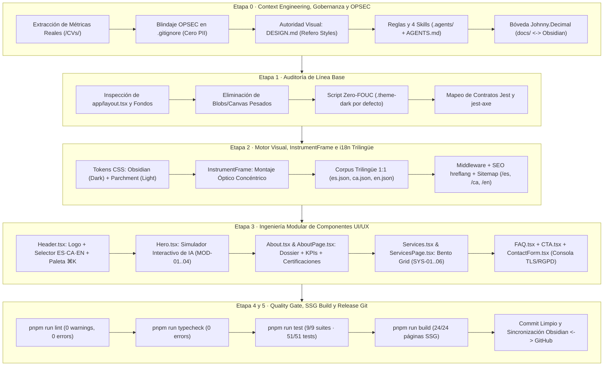

# 🏛️ Memoria Técnica Paso a Paso — Transformación Integral `Ivan Tech Coach v2.0`

Este documento registra de principio a fin, bajo metodología de **ingeniería de sistemas reentrante**, todo el proceso de arquitectura, seguridad, diseño visual, internacionalización trilingüe (`ES · CA · EN`), desarrollo de componentes y verificación automatizada aplicado a la plataforma profesional de **Jaime Iván Rodríguez Morales (`Ivan Tech Coach`)**.

---

## 🧭 Diagrama de Arquitectura del Ciclo de Ingeniería Reentrante

---

## Paso 0 — Ingeniería de Contexto, OPSEC y Gobernanza Agéntica

### 0.1. Auditoría de CVs y Protección OPSEC/PII
- **Análisis de Fuente de Verdad**: Se analizaron los currículums originales en `CVs/` (Español e Inglés) para extraer métricas auditables de más de 20 años de trayectoria (`2001–2026`) y evolucionar el posicionamiento hacia **Consultoría Senior de Infraestructura TI, Ciberseguridad e IA Aplicada**.
- **Blindaje OPSEC ([`.gitignore`](../../.gitignore))**: Se añadió `/CVs/` a `.gitignore` para impedir que documentos PDF locales con datos personales sensibles (como teléfono móvil privado) se suban accidentalmente al repositorio público.

### 0.2. Autoridad de Diseño (`DESIGN.md`)
- Se creó [`DESIGN.md`](../../DESIGN.md) modelado sobre referencias reales de **[Refero Styles](https://styles.refero.design/)**:
  - **Modo Oscuro por defecto (`.theme-dark` — *Obsidian Command Center*)**: Inspirado en **Warp** y **Raycast** (`#040506` lienzo obsidiana, `#121418` tarjetas, `#faf9f6` texto hueso cálido, bordes estructurales de `1px`, acento esmeralda quirúrgico `#10b981` y violeta fósforo `#cbb0f7`).
  - **Modo Claro (`.theme-light` — *Engineering Dossier on Warm Parchment*)**: Inspirado en **Pravah** y **Anthropic** (`#f3f1ed` pergamino cálido, `#ffffff` tarjetas, `#181011` texto tinta profunda, `#d8d4ce` bordes técnicos).

### 0.3. Reglas Maestras y Skills Modulares (`AGENTS.md` + `.agents/`)
- **Reglas Globales del Proyecto**: [`AGENTS.md`](../../AGENTS.md) y [`.agents/rules/engineering-guardrails.md`](../../.agents/rules/engineering-guardrails.md) (uso exclusivo de `pnpm`, prohibición de `npm`/`npx`, seguridad OWASP/RGPD, cero animaciones infinitas de GPU, tipado estricto).
- **4 Skills Especializados**:
  1. [`itc-refero-design-system`](../../.agents/skills/itc-refero-design-system/SKILL.md)
  2. [`itc-cv-ai-content-guard`](../../.agents/skills/itc-cv-ai-content-guard/SKILL.md)
  3. [`itc-qa-security-gate`](../../.agents/skills/itc-qa-security-gate/SKILL.md)
  4. [`itc-obsidian-github-sync`](../../.agents/skills/itc-obsidian-github-sync/SKILL.md)

### 0.4. Segundo Cerebro en Obsidian (`docs/` ↔ `D:\obsidian\IvanTechCoach-Web`)
- Se estructuró la carpeta [`docs/`](../../docs) bajo el sistema **Johnny.Decimal** (`00_MOC`, `01_Estrategia_y_CV`, `02_Sistema_Diseno_Refero`, `03_Arquitectura_y_UX`, `04_Auditorias_y_Historial`) enlazada mediante un *Directory Junction* nativo de Windows con `D:\obsidian\IvanTechCoach-Web`.

---

## Paso 1 — Auditoría de Línea Base (Reentrancia)

1. **Limpieza de Fondo y Rendimiento GPU ([`components/TechBackground.tsx`](../../components/TechBackground.tsx))**:
   - Se eliminaron los generadores de ruido en `<canvas>` y los *blobs* difuminados que drenaban GPU, sustituyéndolos por una retícula arquitectónica estática de `1px` (`--grid-line`) con máscara radial suave.
2. **Hidratación Sin Parpadeo (*Zero-FOUC* en [`app/layout.tsx`](../../app/layout.tsx))**:
   - Se configuró la tipografía dual (`Inter` para interfaz y lectura + `JetBrains Mono` para telemetría, métricas y coordenadas) y el script inline en `<head>` que aplica `.theme-dark` por defecto antes del primer pintado del navegador.

---

## Paso 2 — Motor Visual, `InstrumentFrame` y Arquitectura Trilingüe (`ES · CA · EN`)

### 2.1. Montaje Óptico Concéntrico Sincronizado ([`components/InstrumentFrame.tsx`](../../components/InstrumentFrame.tsx) + [`app/globals.css`](../../app/globals.css))
Para evitar que tu retrato profesional (`ivan-techcoach-hero.webp`) y el logo (`logo.png`) se vieran como imágenes planas pegadas sobre el fondo, y garantizar una estética idéntica tanto en Tema Oscuro como en Tema Claro:
- **Corrección Matemática del Halo Circular (`closest-side`)**: Se aplicó `radial-gradient(closest-side at 50% 50%, ...)` tanto al halo como a la matriz de puntos (`.instrument-frame__grid`), asegurando que la opacidad llegue exactamente a `0` dentro del perímetro circular (`inset: -14px / -18px`) sin formar bordes cuadrados ni salirse de las tarjetas `.blueprint-card`.
- **Doble Anillo Concéntrico con Canal Rebajado (`.instrument-frame__bezel`)**:
  - Anillo exterior cónico de `1.5px` (barrido esmeralda + violeta activado solo en `hover`).
  - Canal rebajado de instrumento (`4px–5px` mediante `background-clip: padding-box, border-box`): en **Modo Oscuro** usa obsidiana profunda (`#07090d` → `#0e1117`); en **Modo Claro** usa piedra cálida (`#f1ede4` → `#e2dcd0`), separando el bisel exterior del fondo oscuro de la fotografía para que el anillo cónico y el anillo interior esmeralda (`--frame-inner-ring`) destaquen con la misma nitidez en ambos temas.
- **4 Escuadras Ópticas Simétricas (`⌜ ⌝ ⌞ ⌟`) y Chip de Telemetría (`ID VERIFICADO · 20+ AÑOS`)**.

### 2.2. Internacionalización Trilingüe Nativa (`ES · CA · EN`)
Dado que operas desde **El Vendrell, Tarragona (Catalunya)** dando servicio tanto a empresas locales catalanas como a clientes en toda España e internacionales:
- **Contratos JSON con Paridad 1:1**:
  - [`content/es.json`](../../content/es.json) (Español)
  - [`content/ca.json`](../../content/ca.json) (Català — terminología técnica genuina: *Intel·ligència Artificial Aplicada, Infraestructura TI, Ciberseguretat, Maquinari AI-Ready*)
  - [`content/en.json`](../../content/en.json) (English)
- **Enrutamiento y SEO Regional**:
  - [`lib/content.ts`](../../lib/content.ts): `supportedLanguages = ['es', 'ca', 'en'] as const`.
  - [`middleware.ts`](../../middleware.ts): Negociación automática de `Accept-Language` (`es`, `ca`, `en`) y protección de rutas.
  - [`components/LangUpdater.tsx`](../../components/LangUpdater.tsx): Sincronización dinámica del atributo `<html lang="...">` y del enlace de salto accesible.
  - [`app/sitemap.ts`](../../app/sitemap.ts) y `generateMetadata` en todas las páginas: generación de etiquetas `hreflang` (`es`, `ca`, `en`, `x-default`) y `openGraph.locale` (`es_ES`, `ca_ES`, `en_US`).

---

## Paso 3 — Ingeniería Modular de Componentes UI/UX

1. **Cabecera, Selector Trilingüe y Paleta de Comandos `⌘K` ([`components/Header.tsx`](../../components/Header.tsx))**:
   - Marca con `/images/logo.png` enmarcado en `InstrumentFrame` (`size="sm"`), evitando cualquier desbordamiento de texto `alt`.
   - Selector trilingüe segmentado (`ES | CA | EN`) con estado `aria-pressed` para cambio de idioma en un solo clic.
   - Modal interactivo `⌘K` / `Ctrl+K` para lanzar diagnósticos del simulador, navegar entre páginas o cambiar preferencias desde el teclado.
2. **Consola Interactiva de Diagnóstico de IA + Sistemas ([`components/Hero.tsx`](../../components/Hero.tsx))**:
   - Presenta tu propuesta de valor y franja de 4 métricas clave (`20+ Años`, `95% FCR`, `+200 GB`, `-30% Costo`).
   - Simulador interactivo con 4 escenarios reales (`MOD-01` Datos Cloud & IA Privada, `MOD-02` Ciberseguridad para IA, `MOD-03` Hardware AI-Ready vs Cloud, `MOD-04` Automatización & SOPs IA), mostrando para cada uno: *Diagnóstico de Campo*, *Arquitectura y Modelos IA*, *Capa de Seguridad/Infraestructura* e *Impacto Verificado*.
3. **Dossier Técnico y Credenciales ([`components/About.tsx`](../../components/About.tsx) y [`components/AboutPage.tsx`](../../components/AboutPage.tsx))**:
   - Retrato en `InstrumentFrame` con placa `ID VERIFICADO · 20+ AÑOS`.
   - 4 tarjetas de KPIs auditables (`KPI-01` a `KPI-04`) y registro cronológico de certificaciones (`FUNDAE 2025`, `Google Cybersecurity 2024`, `Linux/SQL 2024`, `Cisco CCNA 1–3`, `TSU en Informática`).
4. **Matriz de Servicios Bento Grid ([`components/Services.tsx`](../../components/Services.tsx) y [`components/ServicesPage.tsx`](../../components/ServicesPage.tsx))**:
   - 6 módulos codificados (`SYS-01` a `SYS-06`) con métrica de retorno (`OUTPUT`) y etiquetas técnicas.
5. **Protocolos FAQ, CTA y Consola de Contacto ([`components/FAQ.tsx`](../../components/FAQ.tsx), [`components/CTA.tsx`](../../components/CTA.tsx), [`components/ContactForm.tsx`](../../components/ContactForm.tsx))**:
   - `ContactForm.tsx` rediseñado como **Consola de Transmisión de Diagnóstico TLS** con validación trilingüe, sanitización de entradas y sello RGPD/OWASP.

---

## Paso 4 y 5 — Verificación Automatizada (QA Gate) y Compilación SSG

Se ejecutaron las 4 compuertas de calidad obligatorias con `pnpm`:

1. **`pnpm run lint`**: `✔ No ESLint warnings or errors` (0 errores, 0 advertencias tras migrar [`src/components/HeroSection.tsx`](../../src/components/HeroSection.tsx) a `next/image`).
2. **`pnpm run typecheck`**: `tsc --noEmit` completado con 0 errores.
3. **`pnpm run test`**: **`9/9` suites aprobadas (`51/51` tests en verde)**:
   - `__tests__/components/InstrumentFrame.test.tsx` (capas decorativas `aria-hidden`, variantes `sm`/`lg` y `jest-axe`).
   - `__tests__/utf8-validation.test.ts` (integridad UTF-8 y paridad 1:1 de claves entre `es.json`, `ca.json` y `en.json`).
   - `__tests__/lib/content.test.ts` y `__tests__/middleware-routing.test.ts` (soporte y redirección para `/es`, `/ca` y `/en`).
   - `__tests__/components/Header.test.tsx`, `Hero.test.tsx`, `ContactForm.test.tsx`, `accessibility.test.tsx` y `middleware.test.ts`.
4. **`pnpm run build`**: **`24/24` páginas generadas estáticamente (SSG)** incluyendo `/es`, `/ca`, `/en` y sus subrutas `/about`, `/services`, `/contact`, además de `/sitemap.xml` y `/robots.txt`.
